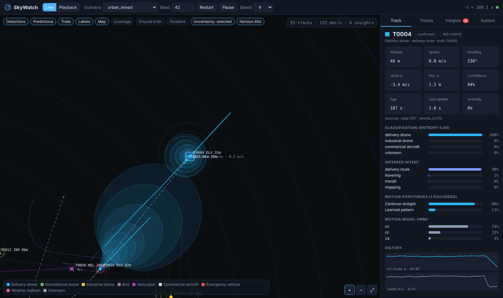
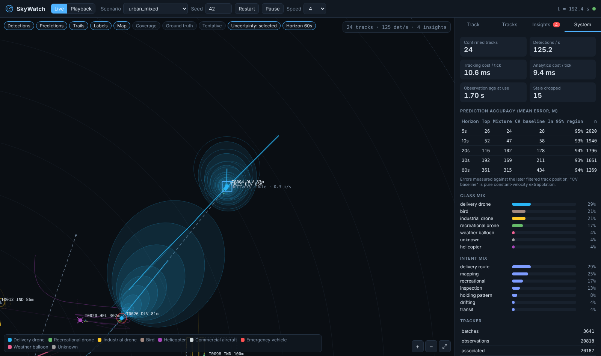
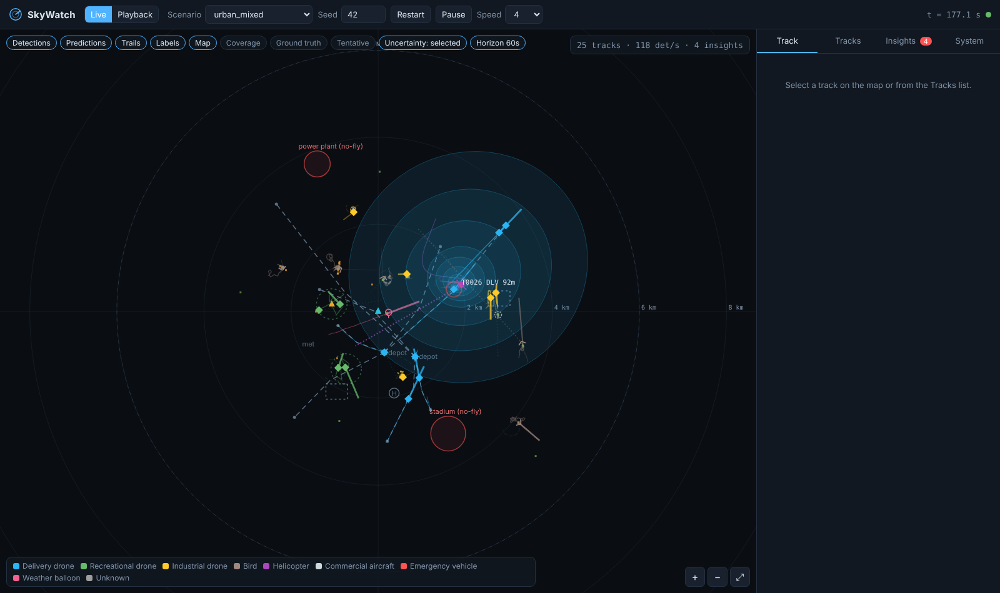
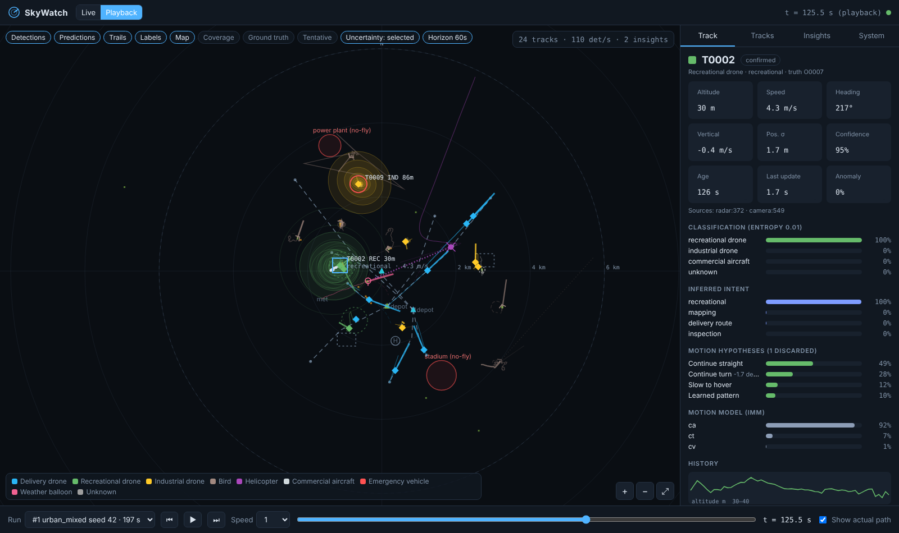

# SkyWatch

**Real-time airspace monitoring, multi-object tracking and probabilistic trajectory prediction.**

SkyWatch watches an observation zone through any mix of sensors (radar, LiDAR,
cameras, ADS-B, drone Remote-ID / GPS telemetry, or simulated equivalents),
fuses their noisy, delayed and intermittent detections into persistent tracks,
classifies every object, infers what it is doing, predicts *several* plausible
futures with calibrated uncertainty, and surfaces anomalous behaviour as
explainable insights - continuously, as every new observation arrives.

| Live map, prediction cone and track inspector | Online accuracy and system view |
|---|---|
|  |  |
|  |  |

```
 sensors / adapters / simulator                       (sensor abstraction)
        |  normalised Observation batches  (ENU metres + covariance + features)
        v
 [event bus: sensor.observations]
        v
 reorder buffer -> IMM multi-model filter + GNN/Hungarian association   (tracking)
        |            identity-constrained, M-of-N confirmation, coasting, duplicate merge
        v
 per updated track (rate-limited):
   classification   MLP p(class|features) + tempered recursive Bayes + OOD -> "unknown"
   anomaly          class-conditional baselines + learned flow map + context checks
   intent           behaviour features -> soft likelihoods -> sticky HMM filter
   prediction       physics (CV / turn / accel / stop) + context (corridor / orbit)
                    + learned MLP residual model, weights updated by Bayes each cycle
        v
 [event bus: analytics.enriched / analytics.insights]
        |-> WebSocket dashboard (live + playback)
        '-> SQLite store (frames, track states, predictions, insights, observations)
```

## Quick start

```bash
pip install -r requirements.txt
python -m skywatch serve                 # http://localhost:8000  (urban_mixed scenario, real time)
python -m skywatch serve --scenario dense_swarm --speed 2
```

Or with Docker:

```bash
docker compose up --build                # http://localhost:8000
```

The repository ships trained models in `models/`. To regenerate them from
simulation (≈ 25 min on 4 cores), and to benchmark:

```bash
python -m skywatch train --episodes 32 --duration 600 --workers 4
python -m skywatch bench --scenario urban_mixed --episodes 4 --duration 600
python -m pytest
```

Other commands:

| Command | Purpose |
|---|---|
| `python -m skywatch scenarios` | list scenarios in `config/scenarios/` |
| `python -m skywatch simulate --scenario emergency_response --duration 900 --jsonl obs.jsonl` | run headless, record for playback, optionally dump raw observations |
| `python -m skywatch serve --source replay:obs.jsonl` | replay a recorded observation log through the live pipeline |
| `python -m skywatch serve --source sbs://receiver:30003` | live ADS-B from dump1090 / readsb (SBS-1 BaseStation feed) |
| `python -m skywatch serve --source external` | no simulator; feed observations via `POST /api/ingest` |
| `python -m skywatch export --run 3 --out exports/` | export a recorded run to CSV |

## The dashboard

* **Map** - live tracks (symbol and colour by class), trails, raw detections by
  sensor, every motion hypothesis (line weight = posterior probability, dash
  style = hypothesis type), 95 % uncertainty cones that widen with the horizon,
  operational corridors, restricted areas, sensors and their coverage, and an
  optional ground-truth overlay in simulation. Pan, zoom and click to select.
* **Track inspector** - kinematics, positional σ, track confidence, contributing
  sensors, class distribution and entropy, intent distribution, each motion
  hypothesis and its weight (plus how many were discarded), IMM mode
  probabilities, anomaly indicators, altitude and speed history.
* **Insights** - explainable anomaly insights with severity, for example "Hovering for 140 s
  (typical maximum for delivery drone: 60 s)".
* **System** - throughput, per-stage cost, online prediction accuracy compared with
  the constant-velocity baseline, calibration, class and intent mix, tracker
  statistics, model status.
* **Playback** - choose any recorded run, scrub or step frame by frame (← / → / space),
  and overlay the *actual* subsequent path of the selected track on what was
  predicted at that moment, with per-horizon error compared with the stated 1σ.

Live mode controls: scenario, seed, restart, pause, simulation speed.

## How it works

### Sensor abstraction (`skywatch/sensors`)
Every modality is normalised to one `Observation`: ENU position in metres with a full
3×3 covariance, plus optional velocity, identity (ICAO address / Remote-ID) and
modality features (radar cross-section, micro-Doppler rotor/flap cues, apparent
size, ADS-B emitter category / emergency status).

* **Radar:** polar noise is propagated into the Cartesian covariance, so the uncertainty
  becomes elongated across the beam at range.
* **Camera:** precise bearing but poor monocular range, which gives cigar-shaped covariances.
* **ADS-B and Remote-ID:** they arrive with realistic latency and message loss.

`sensors/adapters.py` contains the real-world adapters (SBS-1 ADS-B, JSONL replay), and
`POST /api/ingest` accepts this schema from any external gateway:

```json
{"timestamp": 1729930000.12, "sensor_id": "radar-north", "sensor_type": "radar",
 "position": [1520.4, -830.2, 95.0], "sigma": [12, 12, 20],
 "velocity": [3.1, 11.8, 0.2], "identity": "RID-1581F", "features": {"rcs_dbsm": -14.2}}
```
(`covariance` as a 3×3 matrix may be given instead of `sigma`.)

### Tracking (`skywatch/tracking`)
* **IMM-EKF** with constant-velocity, constant-acceleration and coordinated-turn models
  (turn rate is estimated online) on a shared 10-D state. Mode probabilities tell
  you how an object is moving at that moment.
* **Association:** for each sensor scan, a cheap pre-gate selects candidate tracks, then
  χ² gating and a global-nearest-neighbour assignment (Hungarian algorithm) run over
  negative log-likelihood costs. Transponder / Remote-ID identities are hard
  constraints, so tracks never swap identities, and they also allow re-acquisition
  after long gaps.
* **Lifecycle:**
  * Tracks start *tentative* and are confirmed by M-of-N hits, or faster for cooperative targets.
  * A track goes *coasting* when it loses contact, and is deleted after `max_coast_time`.
  * The track confidence combines evidence count, staleness and positional precision.
* **Duplicate merging:** two tracks are merged only if they stay statistically identical
  over several scans *and* were never updated by different detections of the same scan.
  Close formations are therefore kept apart (there's a test for exactly that).
* **Out-of-order data:** a reorder buffer (default 1.6 s) restores timestamp order, and
  older data is dropped and counted. Display positions are extrapolated to "now".

### Classification (`skywatch/classification`)
* **Features:** 23 kinematic and signature features from the last 60 s of the track
  (speed statistics, altitude, climb, turn rate, hover fraction, path straightness,
  RCS, rotor/flap micro-Doppler, apparent size, transponder type and status).
* **Model:** a NumPy MLP trained on simulated tracks *produced by the real tracker*,
  with temperature-calibrated probabilities.
* **Recursive update:** the per-track posterior uses a tempered (geometric) Bayesian
  update, because consecutive windows overlap and are not independent evidence.
* **Unknown objects:** out-of-distribution feature vectors move probability mass to
  `unknown` instead of producing a confident wrong label.

### Trajectory prediction (`skywatch/prediction`)
Each track carries a set of Gaussian *hypotheses* over a 60 s horizon:

| Hypothesis | Source |
|---|---|
| Continue straight / continue turn / continue accelerating | IMM model-conditioned states, closed-form uncertainty growth scaled by class manoeuvrability |
| Slow to hover | velocity decay, for classes that can hover |
| Follow corridor | map-aware: walks the nearest operational corridor in the direction of travel |
| Continue orbit | circle fit to the recent path (inspection orbits, holding patterns) |
| Learned pattern | MLP trained on ground-truth futures: predicts the *residual from constant velocity* in a speed-normalised body frame, with a per-horizon uncertainty model fitted on held-out data |

**Weight updates:** every cycle, each hypothesis's prediction from about 3 s earlier is
scored against where the object actually is (Gaussian likelihood). Those likelihoods
update the weights multiplicatively, and a share of the context prior is mixed back
in. Unlikely futures therefore fade (and are hidden below 4 %), while plausible ones
sharpen and can be revived if behaviour changes.

**Combined prediction:** the moment-matched mixture gives one expected path and the
95 % cone. Online accuracy (against the later filtered track) is computed for every
horizon and shown with the constant-velocity baseline and the cone coverage.

### Intent inference (`skywatch/behavior`)
* **Features:** behaviour is summarised as path straightness, turn consistency and total
  turn, circle-fit quality and radius, survey-leg reversals, hover fraction, climb rate
  and corridor adherence.
* **Intents:** each one (delivery route, transit, inspection, mapping, recreational,
  holding pattern, emergency response, hovering, drifting, anomalous) has an
  interpretable soft likelihood coupled to the class posterior.
* **Filtering:** a sticky HMM forward filter accumulates the evidence over time.

### Anomaly detection (`skywatch/anomaly`)
* **Statistical:** z-scores of vertical rate, acceleration, turn rate and filter
  innovation (NIS) against *class-conditional* baselines. The priors are calibrated
  from simulated normal traffic and keep updating online, but only from tracks that
  currently look normal.
* **Learned:** a spatial flow map (cell × altitude band × object group × heading)
  learned online. Its surprise flags paths that are unusual *for that kind of object
  in that place*.
* **Contextual:** prolonged hover (per-class limits), cooperative-signal silence while
  still seen by sensors, loss of sensor contact, deviation from delivery corridors,
  and restricted-area entry.
* **Output:** each detector produces a graded score. Scores above a threshold become
  rate-limited **insights** with the evidence, rather than binary alarms.

### Simulation (`skywatch/sim`)
* **Agents:** they fly missions composed of behaviour legs. These include delivery
  routes with drop-off hovers, inspection orbits, lawnmower mapping surveys,
  recreational wandering, bird flight with thermal soaring, helicopter transits and
  holds, airliner approaches and overflights, air-ambulance responses, and
  weather-balloon drift with wind shear.
* **Dynamics:** first-order velocity tracking with acceleration limits, plus
  Ornstein-Uhlenbeck gusts.
* **Disturbances:** anomalies (altitude jumps, erratic manoeuvres, long hovers, route
  deviations, transponder loss) can be injected randomly or by script, along with
  sensor outages and degradation.
* **Ground truth:** everything is recorded (classes, intents, anomaly intervals) for
  evaluation.
* **Determinism:** a `(scenario, seed)` pair reproduces exactly. Sensor noise uses a
  separate RNG stream, so changing the sensors does not change the trajectories.

### Architecture & deployment
* Subsystems communicate only through bus topics (`core/bus.py`). The bundled bus is
  in-process asyncio; implementing `EventBus` over Redis Streams, NATS or Kafka moves
  stages into separate services. External sensor gateways already run as independent
  processes via `/api/ingest`.
* Everything is configuration-driven: `config/default.yaml`, plus an optional
  `--config` file, plus environment overrides such as `SKYWATCH__SERVER__PORT=9000`.
* Storage is SQLite (WAL) with a plain schema that ports to PostgreSQL/Timescale.
  Recorded frames power playback, and `track_states`, `predictions`, `insights` and
  `observations` serve offline analysis and training (`skywatch export`).
* Dependencies are NumPy, SciPy, FastAPI and Uvicorn. There is no deep-learning
  framework; the networks are small NumPy MLPs, which suits edge devices.

## Results

All numbers below are measured against simulation ground truth by
`python -m skywatch bench`. Each scenario was run as 4 episodes × 600 s with
seeds that were never used for training. Full reports are in `reports/`.

**Tracking (CLEAR-MOT style, 1 Hz evaluation)**

| Scenario | MOTA | MOTP | Coverage | False-track rate | ID switches / object-hour |
|---|---|---|---|---|---|
| urban_mixed | 0.884 | 10.4 m | 0.914 | 0.029 | 3.0 |
| dense_swarm (≈60 objects, 9-drone formation, bird flocks) | 0.915 | 8.8 m | 0.948 | 0.031 | 8.3 |
| emergency_response (sensor degradation + outage) | 0.839 | 11.8 m | 0.888 | 0.047 | 5.1 |

Position error is about 2–7 m for drones, 6–8 m for manned aircraft and 20–25 m for
birds and balloons. Birds and balloons are small radar targets with intermittent
detection.

**Trajectory prediction - mean 3-D error vs. ground truth (urban_mixed)**

| Horizon | Hypothesis mixture | Top hypothesis | Learned model only | Constant velocity | 95 % region coverage |
|---|---|---|---|---|---|
| 10 s | **38.7 m** | 41.3 m | 44.7 m | 49.6 m | 0.93 |
| 20 s | **87.1 m** | 95.7 m | 103.7 m | 118.2 m | 0.93 |
| 30 s | **147.8 m** | 163.5 m | 171.6 m | 203.2 m | 0.92 |
| 60 s | **359.7 m** | 413.1 m | 364.7 m | 507.1 m | 0.95 |

* **Versus constant velocity:** the mixture is 22–29 % more accurate at every horizon
  (urban_mixed), and 24–33 % more accurate in dense_swarm.
* **Calibration:** the uncertainty is well calibrated, with the true position inside the
  95 % region 92–95 % of the time.
* **Hybrid beats either part:** combining physics, context and learned hypotheses beats
  each of them alone.
* **Headroom:** the best single hypothesis in hindsight ("oracle") would reach 27 m at
  10 s and 184 m at 60 s. That gap is what better hypothesis weighting could still win.

**Classification and intent**

| Scenario | Class accuracy (tracks > 10 s) | Intent accuracy (operated aircraft, tracks > 30 s) |
|---|---|---|
| urban_mixed | 0.990 | 0.878 |
| dense_swarm | 0.999 | 0.884 |
| emergency_response | 0.999 | 0.838 |

* **Strongest intents:** delivery routes (0.96), emergency response (0.98), recreational
  flying (0.90), mapping (0.87) and drifting balloons (0.93).
* **Weaker intents:**
  * Inspection orbits (0.71) and airliner holding patterns (0.48) need most of a
    circuit before they are recognisable.
  * The truth label `anomalous` (0.11) mostly gets the more specific label instead,
    e.g. an injected long hover is reported as `hovering` plus a prolonged-hover insight.

**Anomaly insights** (injected anomalies: altitude jumps, erratic manoeuvres, long hovers,
route deviations, transponder loss)

| Scenario | Event recall | Insight precision | Median delay |
|---|---|---|---|
| urban_mixed | 0.67 | 0.51 | 12.5 s |
| dense_swarm | 0.90 | 0.34 | 7.6 s |
| emergency_response | 0.88 | 0.75 | 11.8 s |

Precision is conservative. Insights about real but un-injected events (losing
contact with an object, aggressive but legitimate recreational flying) count as false.
Hover limits are per class, so an injected 2-minute hover by a *recreational* drone is
deliberately not flagged.

**Throughput.** On a single CPU core, the full pipeline (tracking, classification,
anomaly detection, intent, multi-hypothesis prediction and snapshotting) runs at:

| Scenario | Speed | Confirmed tracks | Detections/s |
|---|---|---|---|
| urban_mixed | 4.5× real time | ~23 | ~140 |
| emergency_response | 5.2× real time | ~21 | ~110 |
| dense_swarm | 1.65× real time | ~60 | ~360 |

**Learned models** (`models/training_report.json`) were trained on 24 randomised episodes
(≈160 k classifier samples, ≈156 k trajectory samples). On held-out episodes:

* The classifier reaches 99.2 % validation accuracy.
* The learned motion model alone cuts constant-velocity error at 60 s from 510 m to
  236 m (the training scenario mix).

> These results come from the bundled simulator, whose sensor and behaviour models are
> idealised. Object signatures in particular are cleaner than in reality, so expect lower
> classification accuracy on real sensors. Retrain or fine-tune on recorded real data,
> which you can export with `skywatch export`.

## Repository layout

```
skywatch/
  core/            data types, event bus, geodesy
  sensors/         sensor interface, simulated sensor models, real-world adapters
  sim/             world, agents, behaviours, scenario engine
  tracking/        IMM filter, multi-object tracker, history utilities
  classification/  features, NumPy MLP, probabilistic classifier
  prediction/      multi-hypothesis predictor, learned motion model
  behavior/        intent inference
  anomaly/         statistical baselines, flow map, detectors
  storage/         SQLite store, playback frames, CSV export
  server/          FastAPI app + dashboard (static/)
  pipeline.py      orchestration over the event bus
  runner.py        simulation / real-time runners
  training.py      dataset generation + model training
  benchmark.py     end-to-end evaluation against ground truth
config/            default.yaml, scenarios/*.yaml
models/            trained models + training report
reports/           benchmark reports
tests/             unit and integration tests
```
